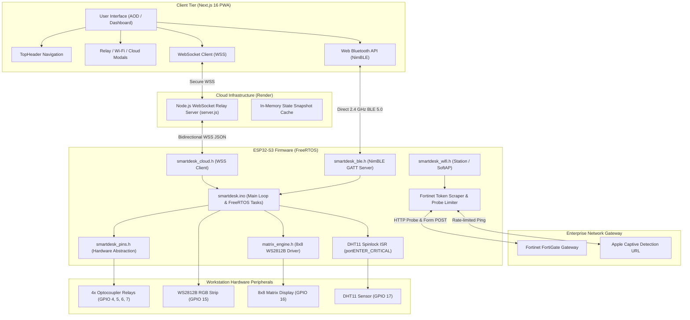

# SmartDesk V2: System Architecture & Operational Specifications

**Lead Engineer:** Anand Kumar  
**System Version:** 2.4.0  
**Target Hardware:** ESP32-S3 (Xtensa Dual-Core 32-bit LX7, 16MB Flash, 8MB PSRAM)  
**Document Classification:** Engineering Design Reference  

---

## 1. System Block Diagram



---

## 2. Communication Protocols & Message Schemas

### 2.1 Bluetooth Low Energy (NimBLE 5.0 GATT)

* **Primary Service UUID:** Custom 128-bit Service
* **Characteristics:**
  * **Relay Characteristic:** Read / Write / Notify — 4-byte payload representing relay loads 0/1.
  * **Telemetry Characteristic:** Read / Notify — Packed binary struct (Temperature, Humidity, Wi-Fi RSSI, System Uptime).
  * **LED Characteristic:** Write — RGB values, brightness, dynamic animation mode index.
  * **Config Characteristic:** Write — Device nickname, strip length, countdown timers.

### 2.2 Cloud WebSocket JSON Schema (`wss://`)

Communication with the Render backend utilizes JSON frames. The parser supports both shorthand and canonical forms:

#### A. Relay Switching Command
```json
{
  "type": "relay_set",
  "channel": 0,
  "state": true,
  "deviceId": "anand_desk_01"
}
```
*Also accepted:* `{ "type": "relay_set", "idx": 0, "load": 1 }`

#### B. Telemetry Broadcast Frame (ESP32 -> Cloud -> PWA)
```json
{
  "type": "telemetry",
  "deviceId": "anand_desk_01",
  "relays": [true, false, false, true],
  "countdowns": [0, 1800, 0, 0],
  "temp": 27.5,
  "humidity": 55,
  "wifi_rssi": -58,
  "ip": "10.12.45.102",
  "uptime": 142050
}
```

#### C. Peripheral Configuration Commands
* **Device Rename:** `{ "type": "device_rename", "name": "Anand Studio Desk" }`
* **LED Strip Length:** `{ "type": "strip_length", "length": 60 }`
* **Matrix Clock / Text:** `{ "type": "matrix_set", "text": "FOCUS MODE", "mode": "ticker" }`
* **Temperature Calibration:** `{ "type": "temp_offset", "offset": -2.0 }`

---

## 3. End-to-End Operational Lifecycle

### Phase 1: Boot & Hardware Self-Test
1. **GPIO Initialization (`smartdesk_pins.h`):**
   * Sets relay pins (`GPIO 4, 5, 6, 7`) to `OUTPUT` and `HIGH` (Active-LOW off state).
   * FastLED allocates buffers for WS2812B strip (`GPIO 15`) and matrix display (`GPIO 16`).
   * Initial NVS preferences loaded (Wi-Fi credentials, relay nicknames, temperature offset).
2. **FreeRTOS Spinlock Setup:**
   * Allocates `s_dhtMux` hardware spinlock for single-wire sensor isolation.

### Phase 2: Dual Network Association
1. **BLE Initialization:** Starts NimBLE advertising immediately with zero delay.
2. **Wi-Fi Station Mode:** Attempts connection to stored SSID/PSK.
   * *If no credentials exist or connection fails after 30 seconds:* SoftAP hotspot activates (`AnandSmartDesk` at `192.168.4.1`) serving captive provisioning.
3. **Enterprise Captive Portal Bypass:**
   * Dispatches HTTP GET to `http://captive.apple.com/hotspot-detect.html`.
   * Follows HTTP 302/307 redirections.
   * If landing page matches Fortinet login, regex extracts the session `magic` token.
   * Submits authentication POST request with credentials.
   * Verifies subsequent HTTP 200 "Success".
4. **Probe Rate-Limiter Activation:**
   * Enforces 60,000 ms cooldown between consecutive probes.
   * Prevents Wi-Fi radio saturation, preserving cool 38°C core temperature.

### Phase 3: Cloud Broker Handshake
1. Connects to `wss://smartdesk-backend.onrender.com`.
2. Transmits authentication frame:
   ```json
   { "type": "auth", "role": "device", "deviceId": "anand_desk_01", "deviceKey": "secret_key" }
   ```
3. Pushes initial state synchronization snapshot upon approval.

### Phase 4: Runtime Execution Loop
* **Core 0 (Networking):** Handles background Wi-Fi, WebSocket events, and NimBLE callbacks.
* **Core 1 (Real-Time Control):**
  * Executes hardware-protected DHT11 bitstream reads.
  * Decrements active relay countdown timers every 1,000 ms.
  * Updates FastLED strip animation frames at 60 FPS.
  * Refreshes 8x8 matrix clock face.
  * Triggers automatic state updates to BLE and Cloud clients upon any state change.

---

## 4. Hardware Isolation & Safety Rules

1. **Load Abstraction:** Relays operate strictly on **LOAD** logic (appliance powered vs unpowered). Electrical inversion is handled exclusively in `smartdesk_pins.h`.
2. **Strobe Rate Protection:** Firmware rejects any LED blink frequency $> 3\text{ Hz}$ with `ERR_PHOTOSENSITIVITY`.
3. **Fail-Safe Startup:** In the event of a sudden brownout or restart, relays default to safe open positions (powered OFF) unless specifically configured otherwise in NVS.

---
*SmartDesk V2 Engineering Specifications — Author: Anand Kumar*
